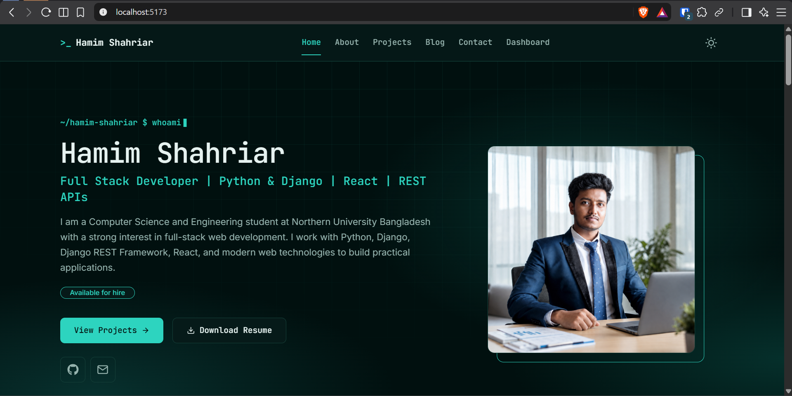
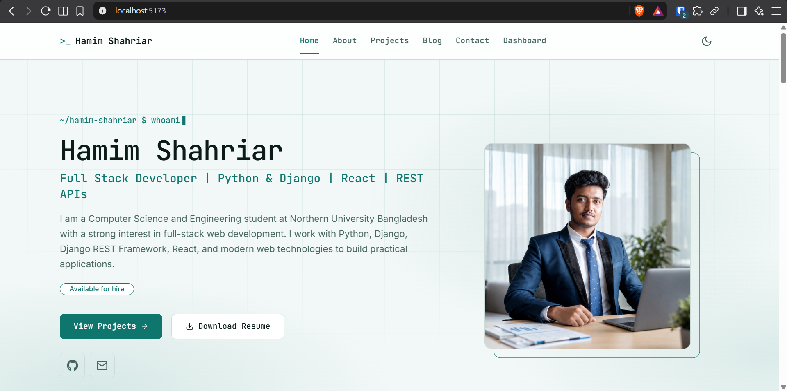
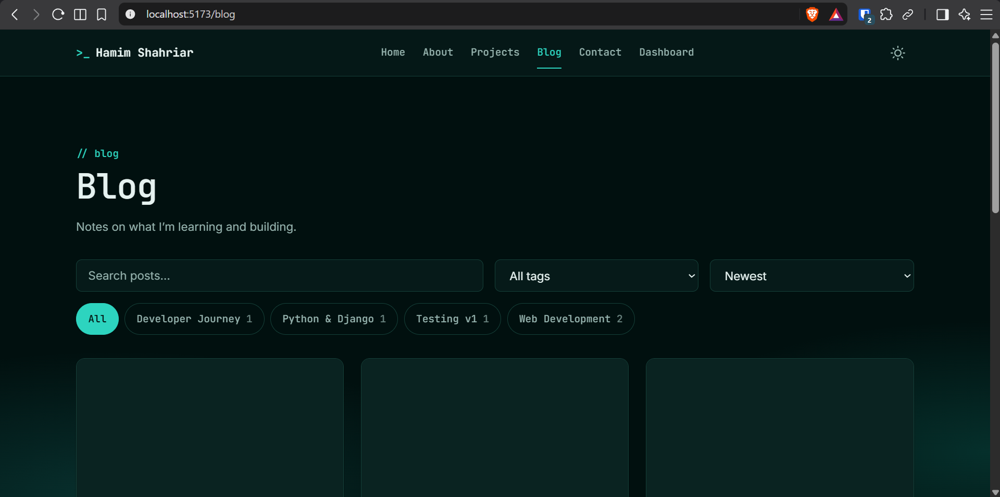
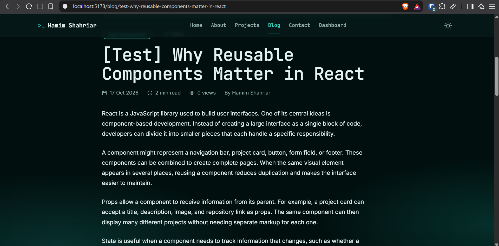
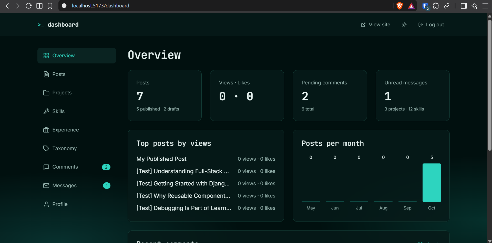

# DevFolio: Portfolio + Blog (React)

React + Vite frontend for my personal portfolio and blog. All content comes from the Django API.

**Backend repo:** https://github.com/HexEnigma/hamim-shahriar-portfolio-backend
**Live site:** _add only after deployment is verified_

## Screenshots
Capture these at 1440px and save them in `docs/screenshots/`:

| | |
|---|---|
|  |  |
|  |  |
|  | |

## Tech stack
React 18, Vite, react-router-dom 6, axios (one instance), TanStack React Query 5, Context API (auth, theme), Tailwind CSS 3.4, react-hook-form + zod, framer-motion, sonner, react-icons, react-markdown (no raw HTML).

## Setup
```bash
git clone https://github.com/HexEnigma/hamim-shahriar-portfolio-frontend.git
cd hamim-shahriar-portfolio-frontend
npm install
cp .env.example .env        # VITE_API_URL=http://127.0.0.1:8000/api
npm run dev
```
Start the backend first. Build with `npm run build`, lint with `npm run lint`.

## Routes
| Route | Access |
|---|---|
| `/`, `/about`, `/projects`, `/projects/:slug`, `/blog`, `/blog/:slug`, `/contact`, `*` (404) | Public |
| `/login` | Public, not linked anywhere |
| `/dashboard`, `/dashboard/posts`, `/dashboard/posts/new`, `/dashboard/posts/:slug/edit`, `/dashboard/projects`, `/dashboard/projects/new`, `/dashboard/projects/:slug/edit`, `/dashboard/skills`, `/dashboard/experience`, `/dashboard/taxonomy`, `/dashboard/comments`, `/dashboard/messages`, `/dashboard/profile` | Protected (owner) |

## Design direction
**B: Developer Terminal**, edited for readability: a dark-first teal palette taken from a custom background image, JetBrains Mono for headings and labels, Inter for reading text, hairline borders, a terminal-style hero prompt, and restrained motion (opacity and 8px translation, 150–250ms, disabled under reduced-motion). The light theme is designed separately with a deeper teal accent.

| Token | Dark | Light |
|---|---|---|
| Background / surface / surface-2 | `#01100f` / `#061a19` / `#0a2321` | `#f2f8f7` / `#ffffff` / `#e6f0ee` |
| Border | `#154039` | `#cbdcd9` |
| Text / muted | `#e6f2f0` / `#96b3ae` | `#0b1b1a` / `#466460` |
| Accent / hover | `#2dd4bf` / `#5eead4` | `#0f766e` / `#115e59` |
| Success / warning / danger | `#4ade80` / `#fbbf24` / `#f87171` | `#15803d` / `#b45309` / `#b91c1c` |

Fonts: JetBrains Mono (headings), Inter (body). Type scale: 12 / 14 / 16 / 20 / 24 / 32 / 48. Spacing: 8 / 16 / 24 / 32 / 48 / 64 / 96. Radii: 4 / 8 / 12. Shadows: sm / md / lg. Motion: 150 / 200 / 250ms. Container: 1200px. All tokens live in `src/styles/tokens.css` and are mapped in `tailwind.config.js`. Measured body-text contrast: _fill in after checking_.

## Structure
```
src/
  api/          axios.js, tokens.js, crud.js, one module per resource
  components/   layout/, ui/, home/, blog/, projects/, dashboard/
  context/      AuthContext.jsx, ThemeContext.jsx
  hooks/        usePortfolio, usePosts, useAdmin, useDebounce, useQueryParams, ...
  pages/        public pages, dashboard/ pages
  routes/       AppRoutes.jsx, DashboardRoutes.jsx (lazy), ProtectedRoute.jsx
  utils/        formatDate, validators, forms, constants
  styles/       tokens.css, index.css
```

## What I would improve with more time
- Component and integration tests (Vitest + Testing Library) and end-to-end tests (Playwright).
- Image optimisation (responsive sizes, WebP conversion on upload) and a rich-text or Markdown toolbar editor.
- Server-side rendering or pre-rendering for better SEO and social previews.
- Accessibility audit with automated tools and screen-reader testing.